# BridgeOps 使用说明

本文面向第一次部署 BridgeOps 的管理员，按「部署 → 接入渠道 → 创建 Key → 客户端接入 → 日常运维」的顺序介绍。各功能更细的设计边界见 `docs/` 下的专题文档。

- [1. 部署](#1-部署)
- [2. 登录与界面概览](#2-登录与界面概览)
- [3. 添加上游渠道](#3-添加上游渠道)
- [4. 充值记录与真实成本](#4-充值记录与真实成本)
- [5. 创建网关 Key 与路由](#5-创建网关-key-与路由)
- [6. 客户端接入](#6-客户端接入)
- [7. 使用记录与费用统计](#7-使用记录与费用统计)
- [8. 监控、事件与通知](#8-监控事件与通知)
- [9. 参数配置](#9-参数配置)
- [10. 网络代理与打码平台](#10-网络代理与打码平台)
- [11. 鹈鹕画廊与智商雷达](#11-鹈鹕画廊与智商雷达)
- [12. 系统设置](#12-系统设置)
- [13. 备份与升级](#backup-and-upgrade)
- [14. 常见问题](#14-常见问题)

---

## 1. 部署

### 1.1 Docker Compose（推荐）

要求：Docker Engine 与 Docker Compose v2，一台可以访问上游服务的 Linux 主机（amd64 / arm64）。

```bash
mkdir bridgeops && cd bridgeops
curl -fsSLO https://raw.githubusercontent.com/Harvey-Mei/BridgesOps-pub/main/docker-compose.yml
curl -fsSL  https://raw.githubusercontent.com/Harvey-Mei/BridgesOps-pub/main/.env.example -o .env
```

编辑 `.env`，至少填写三项：

```env
POSTGRES_PASSWORD=<openssl rand -hex 16 的输出>
APP_SECRET=<openssl rand -hex 32 的输出>
ADMIN_PASSWORD=<管理员登录密码>
```

启动：

```bash
docker compose up -d
docker compose ps          # 三个容器均为 healthy 即可
docker compose logs -f app # 查看日志
```

浏览器打开 `http://服务器IP:8080`，使用 `ADMIN_USERNAME`（默认 `admin`）和 `ADMIN_PASSWORD` 登录。

Compose 会启动三个容器：

| 容器 | 作用 | 数据 |
| --- | --- | --- |
| `postgres` | 唯一的持久化数据库 | 卷 `postgres-data` |
| `redis` | 统计接口 30 秒缓存，可随时丢弃 | 无持久化 |
| `app` | BridgeOps 后端 + 内嵌管理后台 + `/v1` 网关 | 卷 `bridgeops-data`（`config.yaml`） |

`.env` 常用变量：

| 变量 | 默认值 | 说明 |
| --- | --- | --- |
| `HTTP_PORT` | `8080` | 宿主机端口。只想让本机反向代理访问时可写成 `127.0.0.1:8080` |
| `IMAGE_TAG` | `latest` | 镜像版本，生产环境建议固定为 `vX.Y.Z` |
| `APP_SECRET` | 必填 | 加密渠道密码、Token、API Key 的主密钥。**丢失或修改后已有加密数据无法解密** |
| `AUTH_ENABLED` | `true` | 管理员登录开关。公网部署务必保持 `true` |
| `ADMIN_USERNAME` / `ADMIN_PASSWORD` | `admin` / 必填 | 管理员账号 |
| `AUTH_TOKEN_SECRET` | 空 | 会话签名密钥，留空时使用 `APP_SECRET` |
| `POSTGRES_PASSWORD` | 必填 | 数据库密码 |
| `REDIS_MAXMEMORY` | `256mb` | Redis 缓存上限 |

> 首次启动时 BridgeOps 会在数据卷里生成 `/app/data/config.yaml`，后台「系统设置」「参数配置」保存的内容都会写回该文件。环境变量的优先级高于该文件。

### 1.2 配置 HTTPS（建议）

客户端会把网关 Key 以明文 HTTP 头发送，公网使用请务必加 HTTPS。以 Caddy 为例：

```caddyfile
bridgeops.example.com {
    encode zstd gzip
    reverse_proxy 127.0.0.1:8080
}
```

同时把 `.env` 中的 `HTTP_PORT` 改为 `127.0.0.1:8080`，避免绕过反代直接访问。反向代理与 BridgeOps 不在同一台机器时，需要在 `config.yaml` 的 `server.trustedProxies` 中加入反代地址，否则使用记录里的客户端 IP 会显示为反代 IP。

### 1.3 二进制 + systemd 部署

不想使用 Docker 时，可以用仓库脚本构建单个静态二进制（前端已内嵌）：

```bash
./scripts/build-deployment-artifact.sh /absolute/path/to/bridgeops-linux-amd64
```

`packaging/server/` 提供了 `bridgeops.service`、Redis 配置和 Caddyfile 示例；PostgreSQL 配置约束见 [postgresql-migration.md](postgresql-migration.md)，备份恢复见 [recovery.md](recovery.md)。

---

## 2. 登录与界面概览

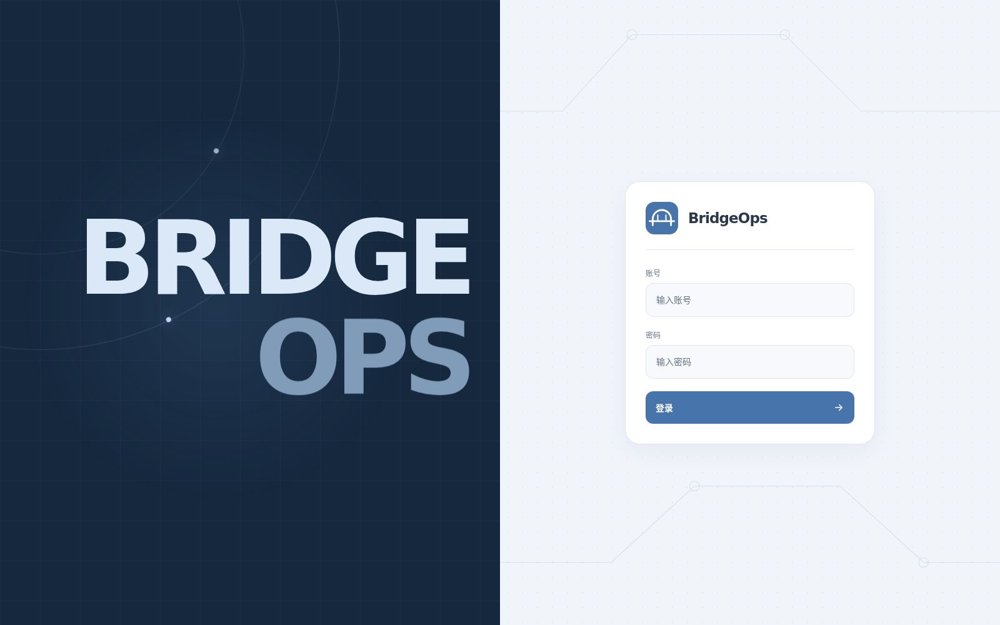

开启 `AUTH_ENABLED` 后，未登录访问只会看到登录页，管理后台的静态资源和版本信息都需要会话。`/v1/*` 网关不使用管理员登录，而是使用你在「密钥管理」中创建的网关 Key。

左侧导航分为四组：

| 分组 | 页面 |
| --- | --- |
| 运营 | 总览、渠道管理、渠道监控、鹈鹕画廊、事件中心 |
| 网关 | 密钥管理、上游变更、使用记录、费用统计 |
| 分析 | 趋势分析、智商雷达 |
| 配置 | 参数配置、通知渠道、打码平台、网络代理、系统设置 |

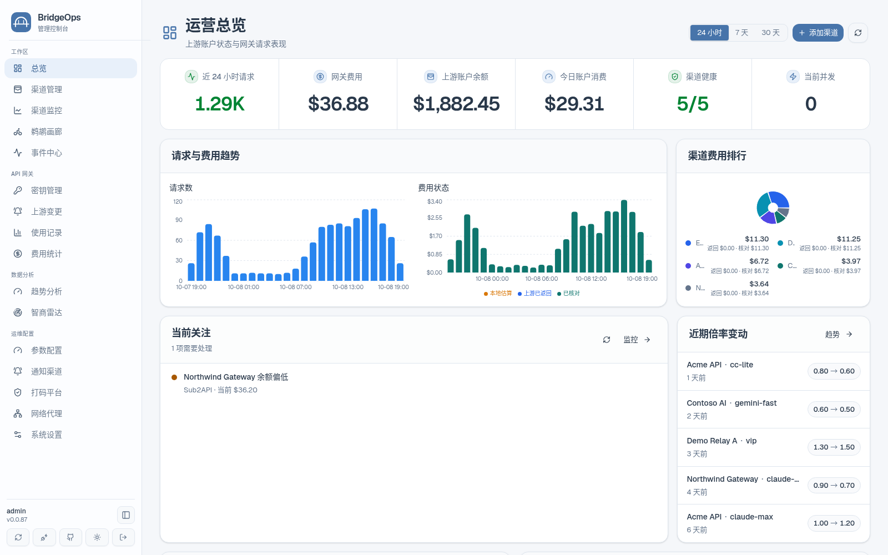

**总览**汇总 24 小时 / 7 天 / 30 天窗口内的渠道与网关 KPI、请求与费用趋势、渠道成本排行、风险提示、余额和倍率变化。注意「上游账户消费」和「网关请求费用」是两套独立口径，页面上会分别标注。

---

## 3. 添加上游渠道

「渠道」指一个上游中转站账号。BridgeOps 目前支持 **NewAPI** 与 **Sub2API** 两类站点，以及直接填写 Base URL + API Key 的直连方式。

进入 **渠道管理 → 添加渠道**：

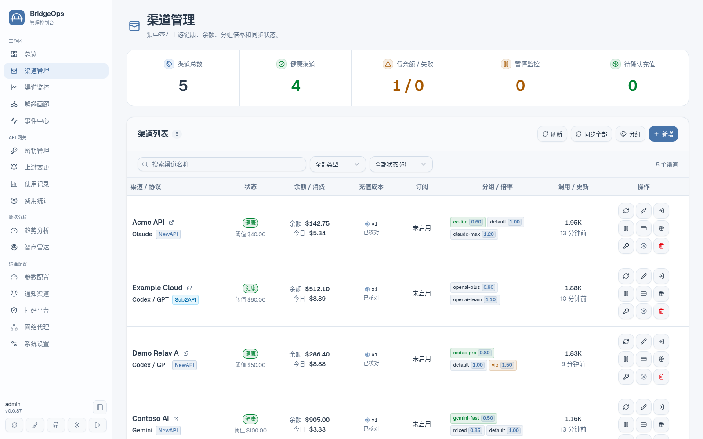

| 字段 | 说明 |
| --- | --- |
| 渠道名 / 排序 | 仅用于展示和排序 |
| 类型 | `NewAPI` 或 `Sub2API`，需与上游站点实际程序一致 |
| 网关协议 | 该渠道对外提供的协议族：OpenAI 兼容（GPT / Grok / DeepSeek）、Claude、Gemini |
| 站点地址 | 上游站点主页地址 |
| 凭据类型 | 见下表 |
| 余额阈值 | 余额低于阈值时告警，并让该渠道所有分组暂停参与路由；余额恢复后自动启用 |
| 网络代理 | 可选，为该渠道单独指定出站代理（见第 10 节） |

凭据类型：

| 凭据类型 | 适用场景 | 续期方式 |
| --- | --- | --- |
| 账号密码 | 最省心。系统自动登录并续期；站点开启验证码时需要配置打码平台 | 自动重新登录 |
| Token + Refresh Token | 站点开启 Cloudflare Turnstile 等无法自动通过的验证 | 保存 refresh token 后自动续期 |
| Token / Cookie | 只能拿到浏览器登录态时 | 失效后需手动重新粘贴 |
| 直连 API Key | 只有 API Key、没有站点后台账号 | 不登录、不访问上游后台；需手动填写分组、倍率和模型 |

保存后可以点击「测试登录」。登录成功后 BridgeOps 会在后台自动：

1. 同步余额、消费、公告和各分组倍率（默认每分钟一次）；
2. 同步每个分组可用的模型列表；
3. 为每个上游分组创建一个**受管 Key**（名称形如 `BOG-p-<随机串>`），网关转发时使用这些 Key。

> BridgeOps 只会删除自己能证明归属的受管 Key，你手工创建的上游 Key 不会被自动删除。

### 遇到 `turnstile verification failed`

Cloudflare Turnstile 没有可靠的免费自动解法。请在渠道编辑框中选择「手动登录接管」，按界面提示在浏览器打开上游登录页、手动通过一次验证，再把浏览器里的 `access_token` / `refresh_token` 导入。之后会话保活会自动续期。

---

## 4. 充值记录与真实成本

很多中转站的「站内余额」与实际付出的现金不是 1:1（例如 10 元买 100 美元额度）。BridgeOps 用**加权资金系数**把站内余额换算成真实现金成本：

```text
新系数 = (充值前原始余额 × 旧系数 + 实付金额) ÷ (充值前原始余额 + 到账额度)
```

- 在渠道卡片上点击「充值」录入实付金额与到账额度，可指定实际充值时间。
- 系统检测到余额异常增长（非 1:1）时会生成「待确认充值」，确认实付金额之前不会改变系数。
- 余额、消费、请求费用、图表和智能路由使用的都是换算后的真实成本；原始数值仍保留用于核对。

---

## 5. 创建网关 Key 与路由

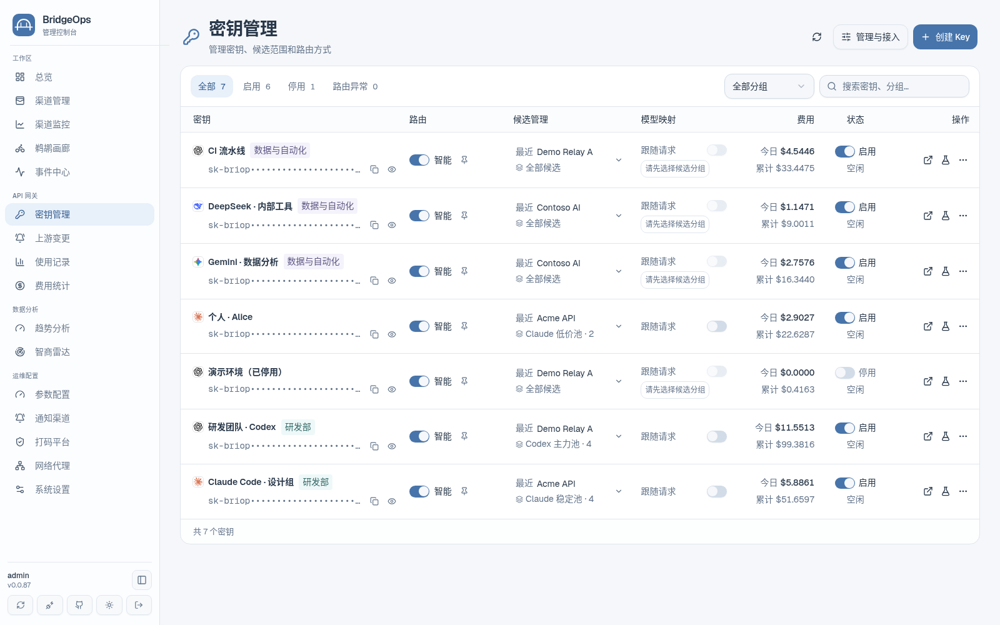

BridgeOps 里有三个都叫「分组」的概念，作用完全不同。先把它们分清楚，再创建 Key 就不会迷糊。

### 5.1 三种「分组」一览

| 名称 | 是谁定义的 | 里面装的是什么 | 作用 | 在哪里看 / 改 |
| --- | --- | --- | --- | --- |
| **上游分组** | 上游中转站 | 站点自己的计费分组，如 `cc-lite`、`codex-pro`，各有倍率 | 决定价格和可用模型；BridgeOps 为每个上游分组自动创建一个受管 Key | 渠道管理「分组 / 倍率」列（只读，自动同步） |
| **候选分组** | 你 | 若干个「渠道 / 上游分组」组合（称为**候选**） | 限定某个 Key 只能在这些候选里智能路由 | 密钥管理 → 候选分组 |
| **Key 分组** | 你 | 若干个下游网关 Key | 按团队 / 用途整理 Key、筛选使用记录；可设置「默认路由」，新建或移入的 Key 自动套用 | 密钥管理 → Key 分组 |

它们之间的关系：

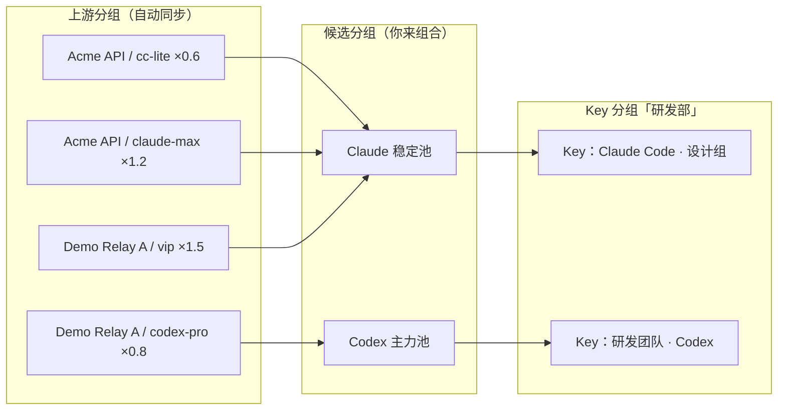

一句话总结：**上游分组是「货架」，候选分组是「你挑出来的一篮子货」，Key 分组是「给 Key 建的文件夹」。** 智能路由只看 Key 绑定的候选分组；Key 分组本身不参与路由打分。

### 5.2 上游分组：自动同步，不需要手工维护

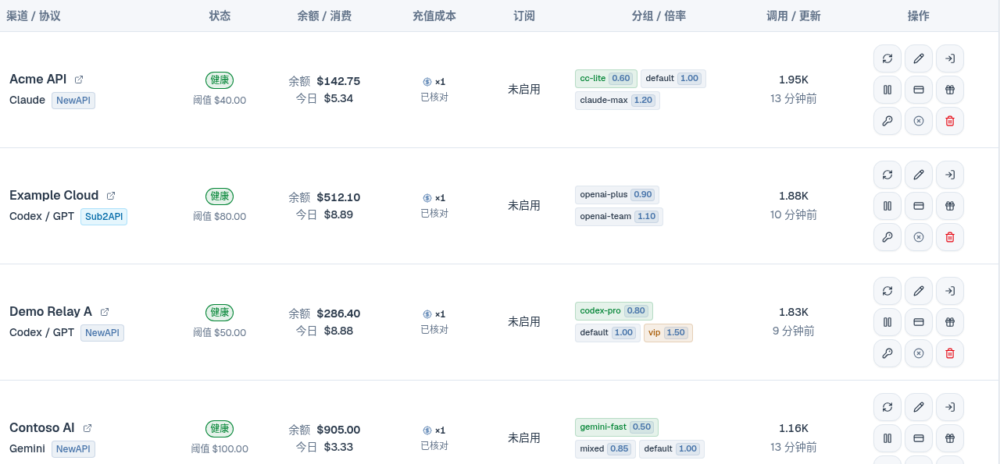

渠道登录成功后，BridgeOps 会自动拉取该账号下的所有上游分组及其倍率（例如 Acme API 有 `cc-lite ×0.60`、`default ×1.00`、`claude-max ×1.20`），并为每个分组创建一个受管 Key。网关转发请求时，实际就是用「某渠道某上游分组的受管 Key」去调用上游。

一个**候选** = 一个渠道 + 它的一个上游分组，例如 `Acme API / cc-lite`。路由打分、故障隔离、价格计算都以候选为单位。上游新增或删除分组时，会出现在「上游变更」页面等待处理（见下文）。

### 5.3 候选分组：限定 Key 能用哪些上游

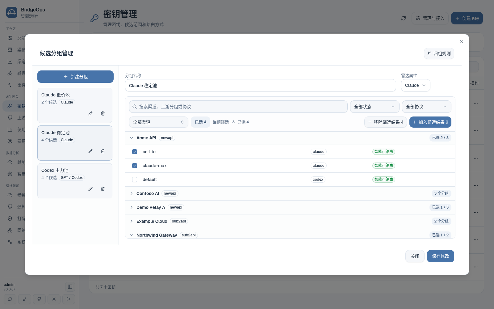

在 **密钥管理 → 候选分组** 中新建分组，展开渠道后勾选具体的上游分组。图中「Claude 稳定池」勾选了 Acme API 的 `cc-lite`、`claude-max`，以及 Demo Relay A、Northwind Gateway 各一个分组，共 4 个候选。

常见用法：

- **低价池 / 稳定池**：把便宜但偶尔不稳的分组放一个池，把官方转发、稳定的分组放另一个池，分别给不同 Key 使用。
- **隔离用途**：生产服务只用稳定池，测试脚本只用低价池，互不影响。
- **模型映射**：Key 的「模型映射」需要先绑定候选分组才能配置（列表里显示「请先选择候选分组」）。

Key 不绑定候选分组时（显示「全部候选」），会在所有协议和模型家族匹配的候选中路由。

### 5.4 Key 分组：整理 Key，并为新 Key 预设路由

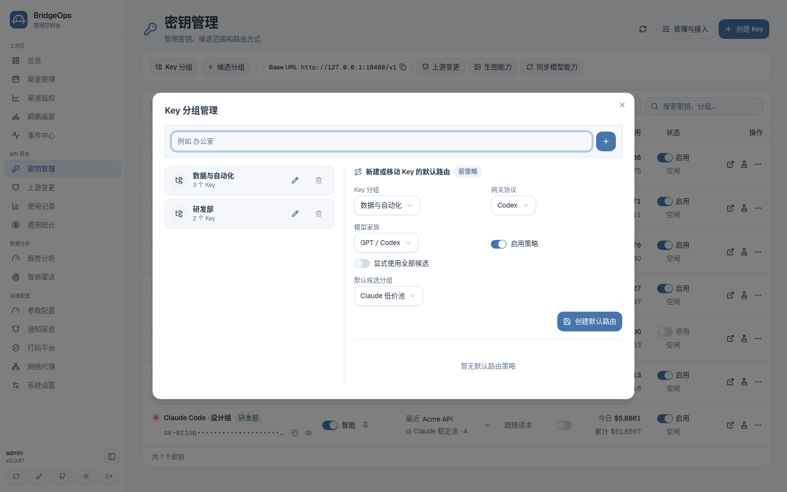

**Key 分组**只是 Key 的归类，例如「研发部」「数据与自动化」。在 Key 列表和使用记录里可以按 Key 分组筛选。

右侧的「默认路由」可以按「网关协议 + 模型家族」为该 Key 分组预设一个候选分组。例如为「研发部」设置「Claude 协议 + Claude 家族 → Claude 稳定池」后：

- 在「研发部」下**新建** Claude Key，或把已有 Key **移入**「研发部」时，会自动绑定 Claude 稳定池；
- 已经在组内的 Key 不会被修改，之后也可以单独改成别的候选分组；
- 打开「显式使用全部候选」则默认使用全部候选，不限定候选分组。

### 5.5 创建 Key

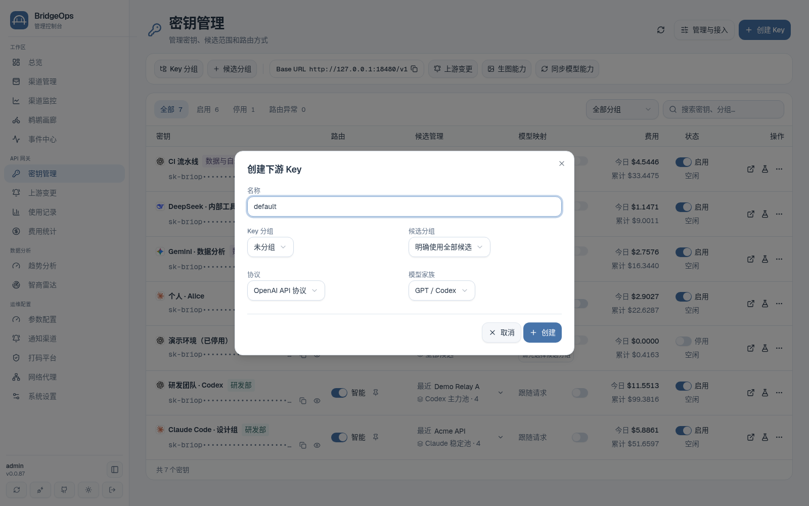

进入 **密钥管理 → 创建 Key**：

| 字段 | 说明 |
| --- | --- |
| 名称 | 便于识别，例如「Claude Code · 设计组」 |
| Key 分组 | 归到哪个文件夹；该分组有默认路由时会自动带出候选分组 |
| 候选分组 | 这个 Key 能用哪些候选；选「明确使用全部候选」则不限定 |
| 协议 | 客户端使用的协议：OpenAI API / Claude / Gemini |
| 模型家族 | GPT/Codex、Claude、Gemini、Grok、DeepSeek 等。智能路由**永远不会跨家族**，GPT Key 不会被路由到 Claude 分组 |

### 5.6 路由方式

| 方式 | 行为 |
| --- | --- |
| 智能路由（默认） | 在 Key 可用的候选中按「真实价格 + 延迟 + 可用性 + 模型能力」打分，选最优者；失败时在有效输出开始前自动切换下一个候选 |
| 固定路由 | 点击 Key 列表「路由」列的图钉按钮选择一个固定候选，保存后开关显示为「固定」。只发往这个渠道 / 上游分组，不打分、不回退、不重试，适合排查或指定渠道 |

智能路由的几条关键规则：

- **不会重放已被上游接受的请求**。一旦上游开始返回有效内容、工具调用，或生图请求已派发，后续出错只记录、不切换，避免重复扣费或重复工具调用。
- 同一候选上的瞬时故障（限流、5xx、连接中断等）最多确认 3 次；连续 3 次失败后该候选进入隔离，需要连续 3 次恢复探测成功才会重新承接流量。
- 会话亲和：同一会话在一段时间内优先复用上次的候选，以提高上游缓存命中率；亲和永远不会替换一个更便宜的当前候选。
- 余额低于阈值的渠道整体退出路由。

### 5.7 候选管理：预览这个 Key 实际会怎么路由

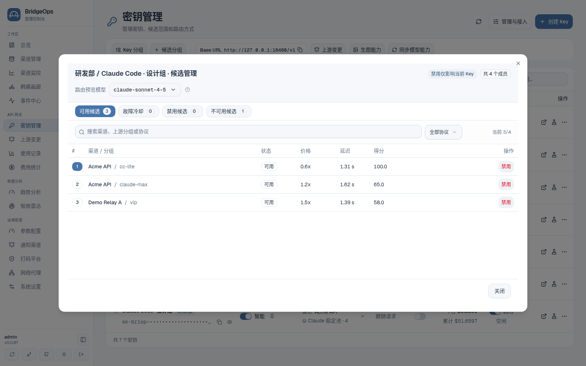

点击 Key 列表「候选管理」列，可以选择一个模型，预览该 Key 当前的候选排序（只模拟，不改变实际路由）。图中「Claude Code · 设计组」绑定了 Claude 稳定池（4 个候选）：3 个可用，按得分排序，`Acme API / cc-lite` 倍率最低排第一；另 1 个因渠道余额不足进入「不可用候选」。

在这里点「禁用」只影响当前 Key，不会改动候选分组本身，也不影响其他 Key。

### 5.8 上游变更

上游新增或删除分组时，**上游变更**页面会列出待处理项。可以手动归入候选分组，也可以配置自动归组规则（详见 [automatic-upstream-group-assignment.md](automatic-upstream-group-assignment.md)）。无法唯一判断归属时系统不会猜测，而是留在待处理列表。

---

## 6. 客户端接入

网关地址：

| 协议 | Base URL | 主要接口 |
| --- | --- | --- |
| OpenAI 兼容 | `https://你的域名/v1` | `/v1/chat/completions`、`/v1/responses`、`/v1/completions`、`/v1/images/generations`、`/v1/models` |
| Anthropic | `https://你的域名` | `/v1/messages`、`/v1/messages/count_tokens` |

API Key 填在密钥管理页复制的网关 Key。命令行验证：

```bash
curl https://你的域名/v1/chat/completions \
  -H "Authorization: Bearer <网关 Key>" \
  -H "Content-Type: application/json" \
  -d '{"model":"gpt-5","messages":[{"role":"user","content":"ping"}]}'
```

### 一键导入客户端

在密钥管理页点击 Key 的「导入客户端」，BridgeOps 会按客户端生成配置：

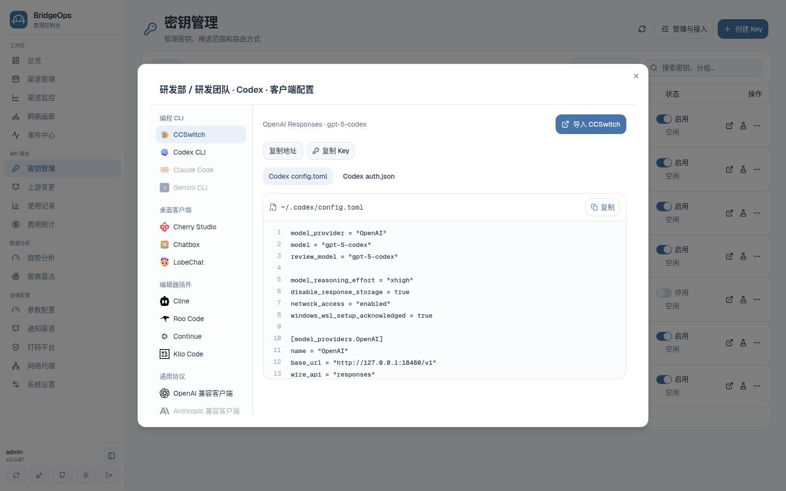

| 客户端 | 方式 |
| --- | --- |
| CCSwitch（Codex CLI / Claude Code） | `ccswitch://` 深链一键导入，HTTPS 或本机地址下还会配置用量查询 |
| Cherry Studio / Chatbox | 深链或配置片段 |
| Continue 等编辑器插件 | 生成配置文件内容与目标路径 |

默认模型只会从已同步、当前可路由的模型中选择。尚未实现的协议组合（例如 Gemini CLI 原生 `/v1beta`）会显示为不可用，详见 [client-import.md](client-import.md)。

手动配置示例：

```bash
# Claude Code
export ANTHROPIC_BASE_URL=https://你的域名
export ANTHROPIC_AUTH_TOKEN=<网关 Key>

# Codex CLI（~/.codex/config.toml）
# [model_providers.bridgeops]
# name = "BridgeOps"
# base_url = "https://你的域名/v1"
# env_key = "BRIDGEOPS_API_KEY"
# wire_api = "responses"
```

---

## 7. 使用记录与费用统计

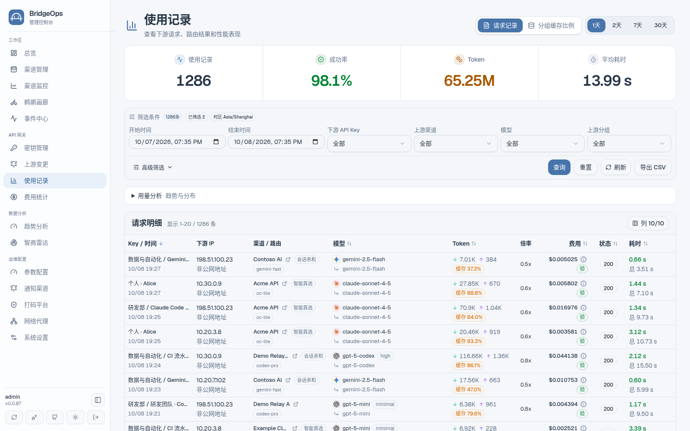

**使用记录**展示每一次网关请求：Key、模型、渠道 / 分组、Token（含缓存读写和缓存命中率）、首字延迟、费用、路由原因和错误信息。支持按时间、Key、模型、渠道、上游请求 ID、结果、路由原因筛选，服务端排序，自定义列，以及导出 CSV。

点击一条记录可查看详情：客户端 IP、推理强度、冻结的倍率与单价、路由尝试过程、会话亲和来源、上游追踪 ID 等。

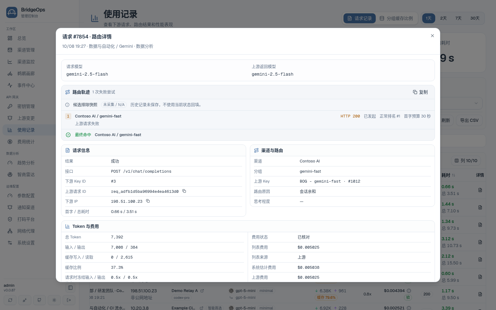

展开「用量分析」可以查看请求、费用趋势和模型 / 渠道分布：

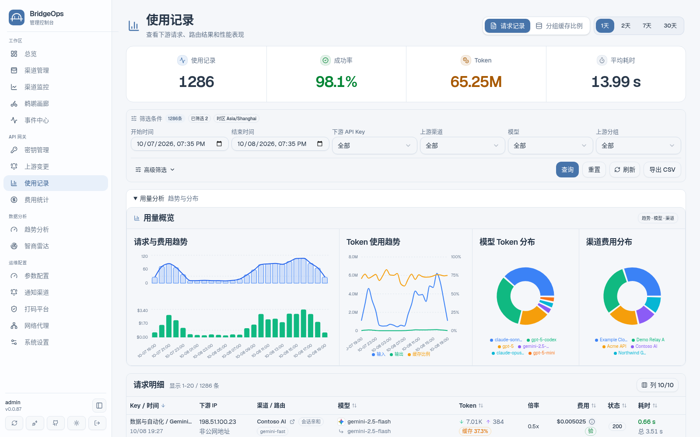

费用口径（优先级从高到低）：

1. 上游返回或后台对账得到的实际费用；
2. 请求时冻结的模型单价 × 实际用量；
3. 都没有时显示「估算」标记的倍率估算值，它只用于展示，不进入账单与聚合。

首字超过 30 秒的智能路由请求旁会出现「雪花」按钮，可将该路由手动冷却一段时间（默认 10 分钟）。

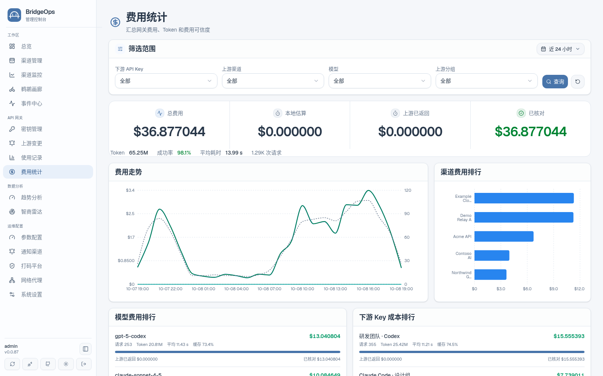

**费用统计**按 Key、模型、渠道汇总费用、Token、RPM/TPM 与趋势。RPM/TPM 使用固定 5 分钟滚动窗口，失败、取消和探测请求不计入。

---

## 8. 监控、事件与通知

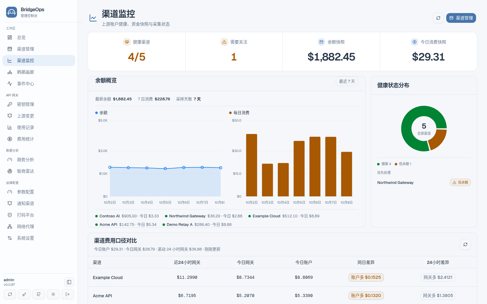

- **渠道监控**：7 天余额 / 消费趋势、健康分布、低余额检测，以及每个渠道「24 小时网关费用 / 业务日网关费用 / 上游消费快照」的对照。
- **趋势分析**：7 / 30 / 90 天的余额、日消费、输入输出倍率变化和受影响模型排行。
- **事件中心**：告警发送记录、上游公告、倍率变动事件集中展示。

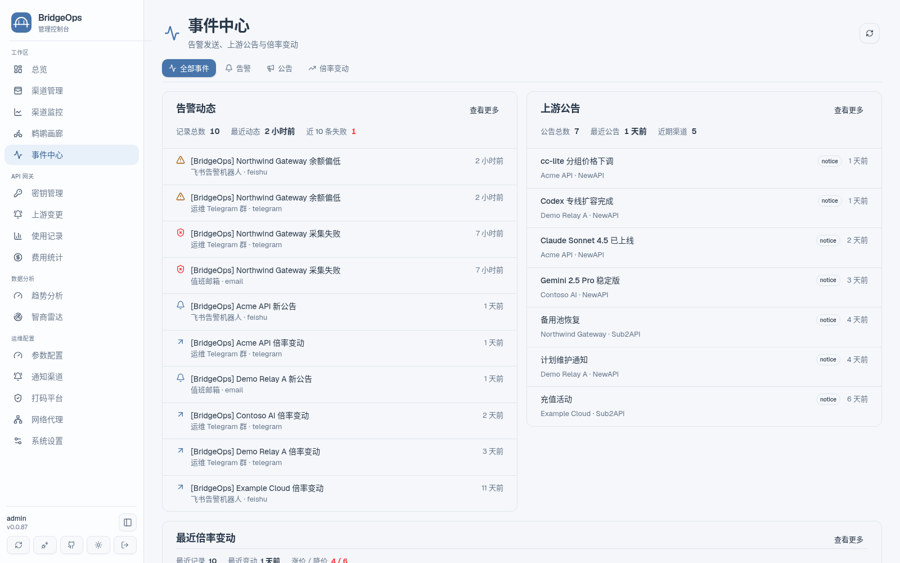

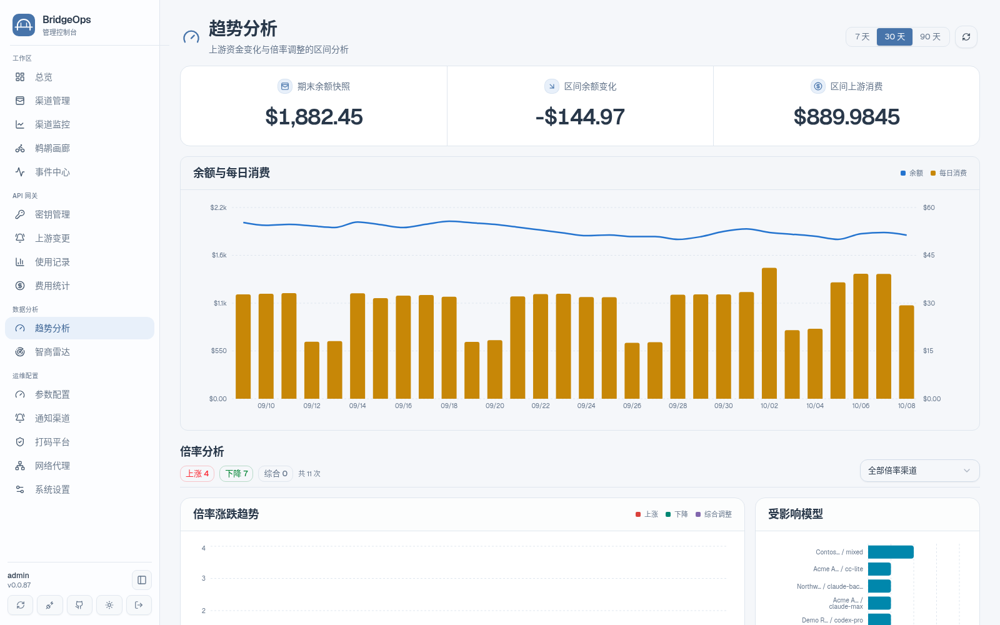

**通知渠道**支持 Telegram、Webhook、Email（SMTP）、企业微信、钉钉、飞书和 Server 酱³。可以分别为倍率变化、余额告警、订阅额度阈值配置接收渠道，并按渠道 / 分组过滤。

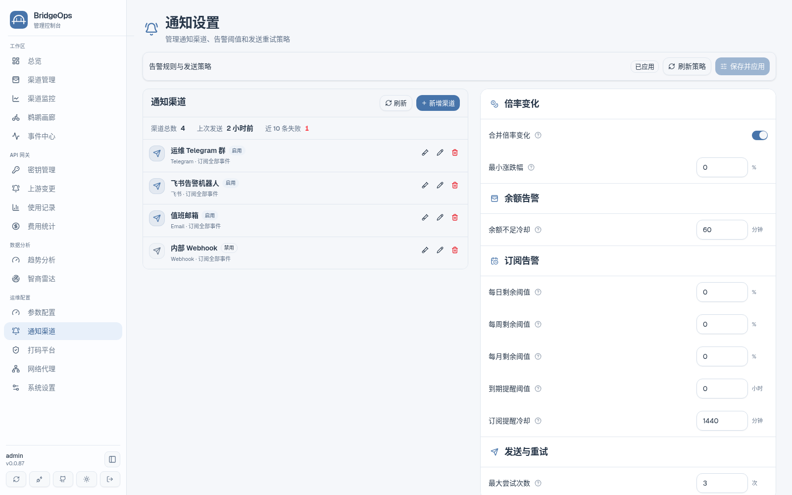

> 163 等邮箱的 SMTP 密码通常是「授权码」，不是网页登录密码。

---

## 9. 参数配置

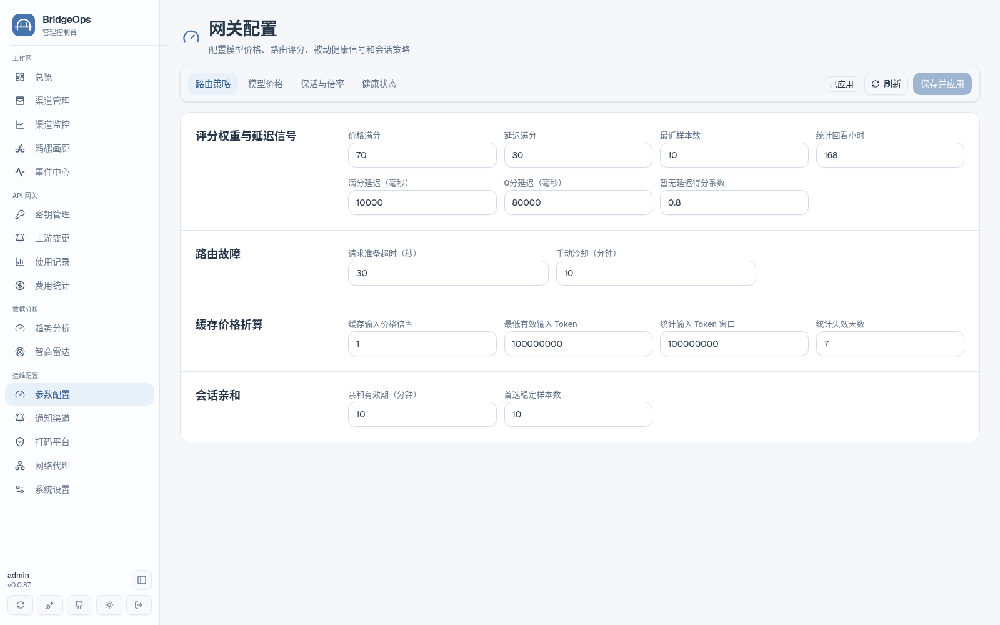

**参数配置**包含四个任务页：

| 任务页 | 内容 |
| --- | --- |
| 路由策略 | 价格 / 延迟权重、延迟样本数、未知延迟系数、缓存成本系数、故障处理、会话亲和 |
| 模型价格 | 各渠道自动采集的模型单价，以及最后兜底的全局价格（每 24 小时从 LiteLLM 同步，可手工补充或修正） |
| 保活与倍率采集 | 渠道会话保活、倍率刷新间隔（默认每分钟） |
| 上游健康 | 所有渠道 / 分组的健康状态、延迟、冷却与恢复情况，可手动解除冷却 |

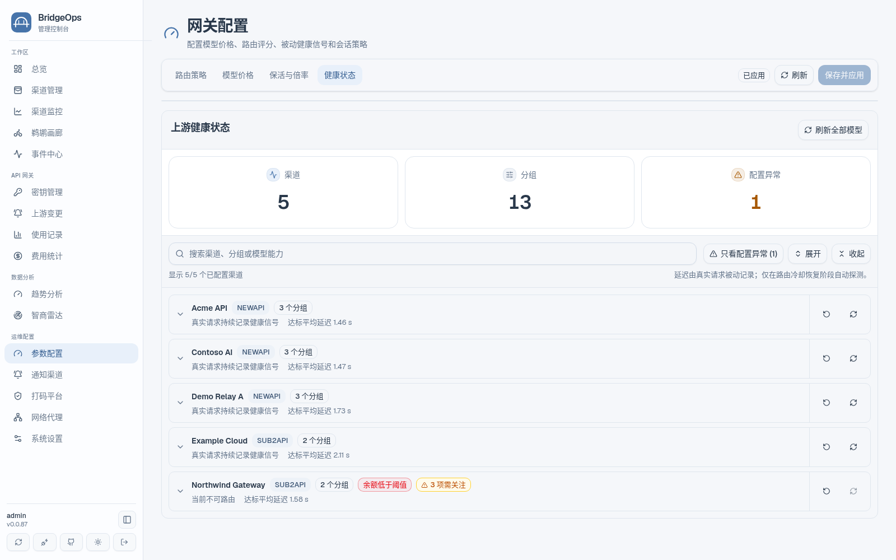

健康的分组不会被主动探测，延迟数据来自真实流量；只有处于冷却中的分组才会自动发起恢复探测。

---

## 10. 网络代理与打码平台

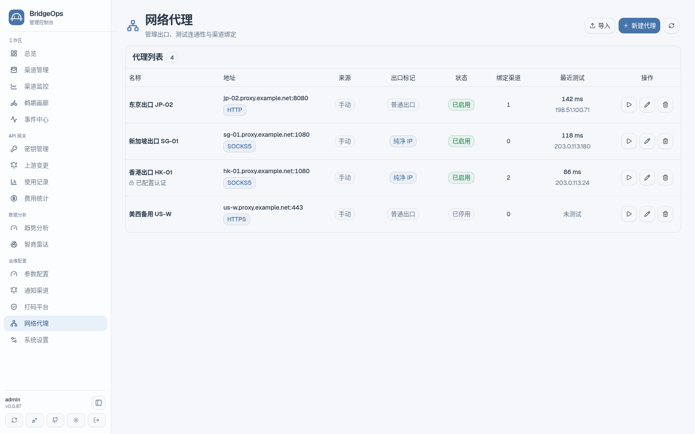

**网络代理**用于给指定渠道配置独立出口，支持 HTTP、HTTPS、SOCKS5，支持批量导入和出口测试。代理认证信息加密保存；未绑定代理的渠道始终直连，不会读取 `HTTP_PROXY` 等环境变量。机场 / 节点订阅需要先用外部工具（如 Clash、sing-box）转换为标准代理端口再填入。详见 [network-proxies.md](network-proxies.md)。

**打码平台**用于账号密码登录时自动处理验证码，支持 CapSolver、2Captcha、AntiCaptcha、YesCaptcha，并可查看余额。

---

## 11. 鹈鹕画廊与智商雷达

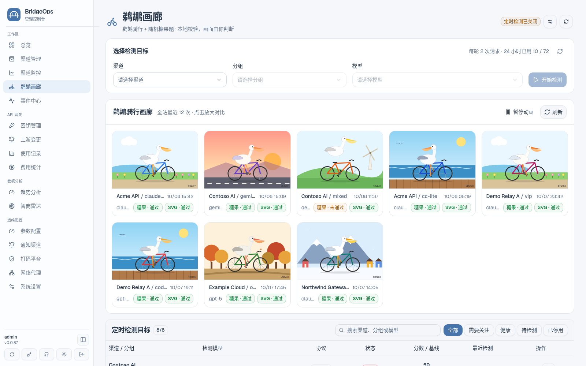

**鹈鹕画廊**是一个本地的模型「体感」检测：选择渠道、分组和模型后，让模型画一幅「鹈鹕骑自行车」SVG 动画，并解一道随机糖果题。程序自动校验结构与答案，画面质量由管理员在画廊中并排对比。检测请求使用该分组的受管 Key，会出现在使用记录中，但不影响路由评分，也不会调用任何第三方检测服务。详见 [model-integrity-check.md](model-integrity-check.md)。

**智商雷达**展示 Codex 与 Claude Code 的公开社区评测摘要（能力分、测试成本、延迟），并在本地保留变化历史。这些是第三方社区数据，不是官方评分。

---

## 12. 系统设置

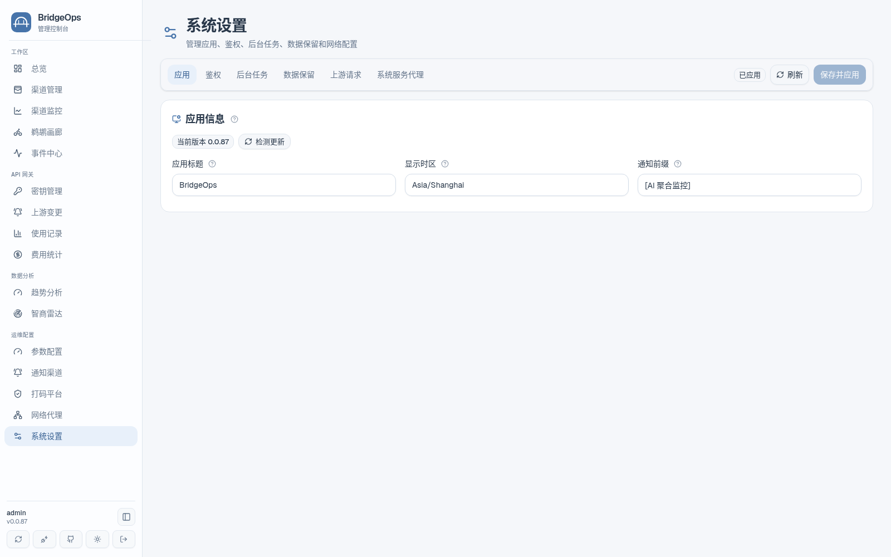

系统设置包括：应用名称与时区、管理员鉴权、后台任务调度、数据保留策略、上游 HTTP 行为、系统服务代理、版本检查。

- 时区默认 `Asia/Shanghai`，控制所有时间显示与筛选；数据库内部始终使用 UTC 存储绝对时间。
- 已保存的密码、密钥不会通过接口返回；输入框留空表示保持原值。
- 「系统服务代理」只用于版本检查、价格同步等系统请求，渠道流量请使用「网络代理」。

---

<a id="backup-and-upgrade"></a>

## 13. 备份与升级

### 备份（Docker Compose）

所有业务数据都在 PostgreSQL 中，Redis 不需要备份。**请同时妥善保存 `.env` 里的 `APP_SECRET`**，否则备份中的加密凭据无法解密。

```bash
# 备份
docker compose exec -T postgres pg_dump -U bridgeops -d bridgeops -Fc > bridgeops-$(date +%F).dump

# 恢复到一套全新的部署（先只启动数据库）
docker compose up -d postgres
docker compose exec -T postgres pg_restore -U bridgeops -d bridgeops --clean --if-exists < bridgeops-2026-01-01.dump
docker compose up -d
```

systemd 部署可使用带一致性校验的 `scripts/bridgeops-backup-postgres.sh` / `bridgeops-restore-postgres.sh`，见 [recovery.md](recovery.md)。

### 升级

```bash
# 先备份，再拉取新镜像
docker compose pull app
docker compose up -d
docker compose logs -f app
```

数据库迁移在启动时自动执行，并做校验和检查。生产环境建议在 `.env` 中固定 `IMAGE_TAG=vX.Y.Z`，升级时修改版本号。后台侧边栏会根据 GitHub Releases 提示新版本。

---

## 14. 常见问题

**打开页面无响应 / 连接被拒绝**
确认 `docker compose ps` 中 `app` 为 healthy，防火墙放行了 `HTTP_PORT`。若自行编写 compose，需要设置 `SERVER_HOST=0.0.0.0`，否则服务只监听容器内的 127.0.0.1。

**启动报 `APP_SECRET is required` / `ADMIN_PASSWORD is required`**
`.env` 中对应变量为空，填写后重新 `docker compose up -d`。

**使用记录的时间差了 8 小时**
接口返回的是带时区的绝对时间，前端按「系统设置 → 时区」显示。不要修改数据库时区，也不要在客户端手动加 8 小时。

**为什么请求落到了更贵的分组？**
便宜的候选可能当前不可用：余额不足、隔离中、Key 未就绪、模型不支持、上下文超限，或者在有效输出前发生了故障并切换。请在使用记录详情的「路由尝试」中查看每一步原因。

**为什么费用显示为「估算」？**
上游没有返回费用、后台对账尚未匹配，且请求时没有冻结到模型单价。可以在「参数配置 → 模型价格」补充该模型的价格。

**RPM / TPM / 并发和上游后台不一致**
BridgeOps 只统计经过本网关的流量；同一上游账号被其他客户端使用时，两边数据自然不同。

**版本检查失败**
版本检查依赖 GitHub Releases 接口；服务器无法访问 GitHub 时可在「系统设置」中配置系统服务代理。
